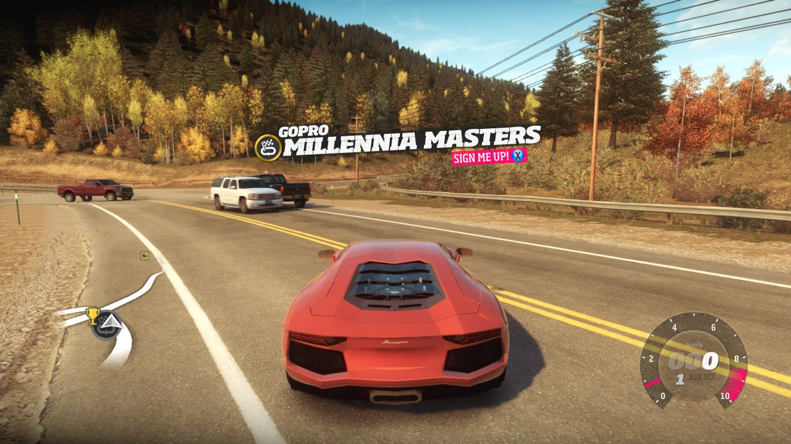
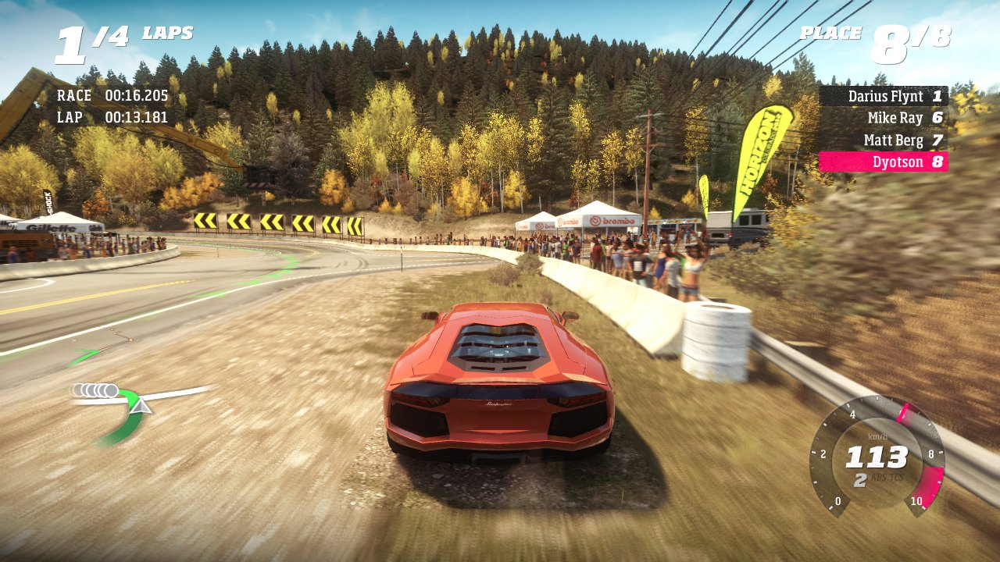
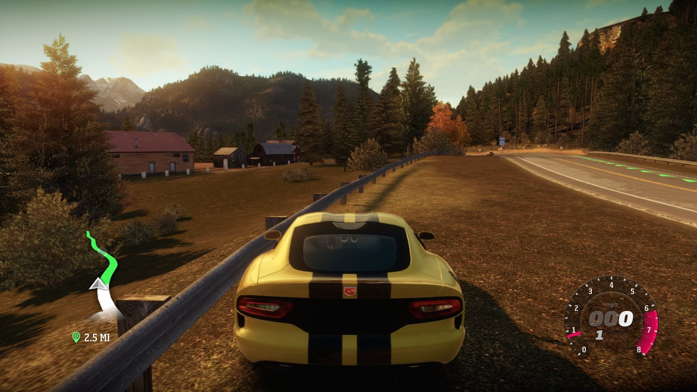
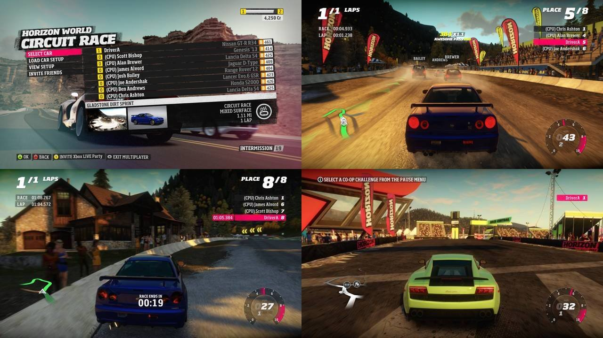

# RecompiledForzaHorizon

A native PC port of **Forza Horizon (Xbox 360)**, made by statically recompiling the
original PowerPC executable to C++ with the [ReXGlue SDK](https://github.com/rexglue/rexglue-sdk).
It follows the approach of [RecompiledHaloReach](https://github.com/Dyotson/RecompiledHaloReach),
and comes with its own self-hostable online server (`server/`) that stands in for Xbox LIVE
and Turn 10's services.

This repository contains **no game code and no game data**. You need your own copy of the
game (the Games on Demand package of the base version, Title ID `4D5309C9`). The recompiled
C++ is generated from your copy on your machine; no binaries are published here.

## Screenshots

Captured from the recompiled game running natively on Linux.

| | |
|---|---|
| <br>Free roam | <br>Circuit race against 7 AI drivers |
| <br>Free roam, Colorado mountains | <br>Horizon World online playlist: race lobby and races |

## What works

- **Single player:** boot, menus, the opening drive, free roam, festival events and races
  (tested with a circuit race against 7 AI drivers), audio, saves, and all DLC packages.
  Saves from Xenia Canary can be continued.
- **60, 120 or 144 fps:** `frame_rate = 60` (or 120, 144, any rate up to 240) in
  `forza.toml`. Free roam holds 60, about 115 at 120 and 112 at 144; a race with 7 AI cars
  60, 76 and 70, bound by the GPU emulation. Physics, the race clock and online play keep
  their timing ([`docs/framerate.md`](docs/framerate.md)).
- **Online** (through the Forza Live server): sign-in as a Gold member, Find Game and races
  with XP and credits, parties and custom games, a shared online free roam (the Horizon World
  playlist), Playground Games modes (Infected, Cat & Mouse, King), leaderboards and Rivals
  (times, ghosts and bounties shared between players), car clubs and the club garage, and
  the Message Center (beaten-time alerts, gifts, club requests, invitations, news).
  Details in [`docs/online_vision.md`](docs/online_vision.md) and [`docs/title_services.md`](docs/title_services.md).

## Known issues

- Early work in progress; tested mostly in short sessions.
- The Auction House exists on the server only; its screens were removed from the game, and
  the storefront answers empty.
- Keyboard and mouse (`--mnk_mode=true`) is untested; use a controller.
- Windows builds are cross-compiled from Linux and have only been tried under Proton, not
  on Windows itself.
- Races with many AI cars are GPU-bound and below 60 fps.

## Requirements

- Linux x86-64 with a Vulkan 1.3 GPU, about 10 GB of free RAM and 20 GB of disk
  (7.6 GB of extracted game files plus the build). Windows: see below.
- Your own Forza Horizon Games on Demand package (`4D5309C9/00007000/<name>` plus
  `<name>.data/`), base version.
- Clang (tested with 23), CMake >= 3.25, Ninja, Python 3, Git, OpenSSL (for
  `tools/xex_image.py` only).
- [ReXGlue SDK](https://github.com/rexglue/rexglue-sdk) 0.10.0.24 nightly
  (`nightly-20261002-bd833a2a`).

## Building (Linux)

```sh
# 1. The ReXGlue SDK nightly, unpacked to ~/rexglue-sdk-nightly/0.10.0.24/linux-amd64
# 2. The game files, extracted from your Games on Demand package (only read)
python3 tools/xcontent_extract.py /path/to/4D5309C9/00007000/<name> extract extracted/game
# 3. The patched Xenos GPU plugin and codegen tool (clones the SDK to ~/rexglue-sdk-src-forza,
#    applies patches/rexglue-sdk/ and installs an overlay at ~/rexglue-sdk-patched-forza;
#    the stock rexglue's dot products overflow to infinity, Xenon's to QNaN, and free roam
#    crashes without it)
tools/build_rexglue_sdk.sh
# 4. Configure (the first configure runs codegen with the overlay's rexglue, about a
#    minute) and build
cmake -S forza-recomp -B forza-recomp/out/build/linux -G Ninja -DCMAKE_BUILD_TYPE=Release \
  -DCMAKE_CXX_COMPILER=clang++ -DCMAKE_PREFIX_PATH=$HOME/rexglue-sdk-nightly/0.10.0.24/linux-amd64
ninja -C forza-recomp/out/build/linux
```

## Windows

The Windows version is cross-compiled from Linux with clang/clang-cl and lld-link, after the
Linux build above (its codegen output in `forza-recomp/generated/` is reused, and step 3
checks out the SDK source). `tools/build_windows.sh` builds the ReXGlue SDK for Windows
from `~/rexglue-sdk-src-forza` with this project's patches and the Vulkan backend into
`~/rexglue-sdk-patched-forza/0.10.0.24/win-amd64`, then the game, and packages it in
`forza-recomp/out/dist/windows` (`--sdk-only` and `--game-only` split the long build):

```sh
brew install llvm lld                                  # clang, clang-cl, lld-link
xwin --accept-license splat --output ~/.local/opt/xwin/sdk   # MSVC CRT + Windows SDK (Microsoft's license)
tools/build_windows.sh
tools/package_linux.sh                                 # the Linux package, forza-recomp/out/dist/linux
```

On Windows, extract the package, install the Microsoft Visual C++ 2015-2022 x64
redistributable, extract your game files with `python xcontent_extract.py` and run
`play.bat C:\path\to\extracted\game` (`--offline` for no Xbox LIVE; it starts a local
Forza Live server when Python is installed, or uses `FORZA_SERVER` / `live_server` in
`forza.toml`). Saves, the online identity and the log go to `Documents\forza`.

## Playing

```sh
tools/play.sh                 # play with your own profile (~/.local/share/forza)
tools/play.sh --xenia         # continue your Xenia Canary save (a copy)
tools/play.sh --offline       # without Xbox LIVE
```

Install DLC once with `python3 tools/install_dlc.py /path/to/4D5309C9/00000002`. Controllers,
saves, the Xenia save import and more are in [`docs/playing.md`](docs/playing.md).

### Playing online

`play.sh` starts a local Forza Live server for the session. To play on the public server,
set in `forza.toml` next to the binary:

```toml
live_server = "dyotserver.ddns.net:21200"
```

(or start with `FORZA_SERVER=dyotserver.ddns.net:21200`). You forward no ports. To run your
own server, see [`docs/hosting.md`](docs/hosting.md).

## More documentation

[`docs/PROJECT.md`](docs/PROJECT.md) (status log, findings, debugging recipes),
[`docs/playing.md`](docs/playing.md), [`docs/hosting.md`](docs/hosting.md),
[`docs/perf.md`](docs/perf.md), [`docs/framerate.md`](docs/framerate.md).

## Legal

Forza Horizon is © Microsoft. This project is not affiliated with, endorsed by or
sponsored by Microsoft, Playground Games or Turn 10 Studios. It contains no game code or
assets; you must own the game. See [`LICENSE`](LICENSE).
